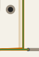

done

## Feature requests

1. **Net-class coupling check in `kat pcb check`.**
   - Flag copper of net class A (e.g. amplifier outputs `OUT*`) that overlaps,
     or comes closer than a given distance to, copper of a *different-index* net
     of class B (e.g. high-impedance inputs `IN*`) on the same or an adjacent
     layer.
   - Report the overlap length/area and a parallel-plate capacitance estimate
     from the stack-up.
   - Motivation: in multi-channel transimpedance amplifiers with high feedback
     resistance (MΩ range, feedback capacitance ≈ 0.1 pF), about 2 mm of
     overlap between one channel's output and another channel's input, on
     adjacent layers 0.1 mm apart, gives ≈ 0.2 pF. That is ≈ 0 dB crosstalk.
     Such a coupling is easy to miss in review and is not caught by DRC.
   - Also useful: a rule that "net class X is only allowed on layers …" and a
     rule that requires "a solid plane under net class X".
2. **`kat pcb stamp --side bottom` (flip a block to the other side).**
   Dense double-sided designs place the same checked block on both sides, e.g.
   half of many amplifier blocks on the bottom. Without this option a
   mirrored second block is needed, which doubles the design and check effort
   and lets the two copies drift apart.

   **CLI.** `kat pcb stamp PCB BLOCK_PCB INST… --at X,Y [--rot R] --side bottom
   [--layer-map auto|roles|"L1=L6,…"] [--allow-asymmetric]`.
   Re-stamping keeps the side recorded for the instance (stored in the group or
   instance data), so `stamp all` does not silently flip blocks back.

   **Geometry.**
   - Mirror about the block's vertical axis (KiCad's default left/right flip),
     **then** rotate. `--rot` is as seen from the top, the same as for
     top-side instances.
   - `--at` names the top-left corner of the flipped block outline as seen from
     the top, so top and bottom instances share one placement grid. Document
     the convention, because the block origin moves to the other corner when
     mirrored.
   - `--step` applies unchanged. Port points are mirrored too, and the port
     check uses the mirrored points.

   **Layer mapping.** This is the core of the feature.
   - `auto` (default) uses the mirror map L(k) ↔ L(N+1−k):
     F.Cu↔B.Cu, In1↔In(N−2), and so on. KiCad already has this map:
     `FlipLayer(layer, copperCount)`, the same one used by
     `PCB_TRACK::Flip`/`ZONE::Flip`.
     It also flips the paired technical layers: F/B Mask, Paste, SilkS, Fab,
     CrtYd and Adhes. `User.*` and `Edge.Cuts` stay as they are.
   - `auto` is only allowed if the stack-up is **mirror-symmetric**, judged on
     the design board's stackup:
     - dielectric thickness, εr and material mirror around the centre within a
       tolerance;
     - copper thickness of L(k) equals that of L(N+1−k);
     - the block board and the design board have the same layer count.

     Otherwise refuse with a per-layer diff, unless `--allow-asymmetric` is
     given. Why this matters: sensitive parasitics such as a sub-pF feedback
     capacitance, or an input guard, depend on the dielectric thickness to the
     reference plane. An asymmetric stack would silently change them on every
     flipped instance.
     Example of a symmetric 6-layer stack: dielectrics
     0.1 / 0.5 / 0.15 / 0.5 / 0.1 mm, all copper 35 µm.
   - `roles`: the block board and the design board each declare layer roles,
     for example in the board's `.kat` metadata or `kat pcb environment`:
     ```
     block (top):  L1=in_signal  L2=gnd_ref  L3=out  L4=out  L5=gnd_ref  L6=back_signal
     design:       L1=in_signal_top … L6=in_signal_bottom
     ```
     The flip maps by role ("in_signal on the component side",
     "gnd_ref adjacent to it"). This works for asymmetric stacks too, as long
     as the roles exist on both sides. If a role cannot be mapped, the stamp is
     refused.
   - An explicit map, `--layer-map "F.Cu=B.Cu,In1.Cu=In4.Cu,…"`, takes
     precedence. It is checked for bijectivity, and outer layers must map to
     outer layers.

   **Vias.**
   - Through vias are unchanged.
   - Blind, buried and µvias: the span (a, b) maps to (map(b), map(a)),
     e.g. a µvia L1–L2 becomes L5–L6 on a 6-layer board.
   - Refuse if the mapped span is not an allowed via type or layer pair in the
     design's stack-up or DRC rules. Also check the drill and annular ring
     constraints for that span.
   - KiCad 9+ padstacks with front/inner/back modes: swap the front and back
     definitions and map the per-layer inner definitions.

   **Other copied items.**
   - Footprints use KiCad's footprint flip. Pads, mask, paste, courtyard, fab
     layer, silk and reference/value text are mirrored and become readable from
     the bottom.
   - Zones and keep-out/rule areas have their layer sets mapped, keep their
     priority and get their fill invalidated; run `pcb refill` afterwards.
   - Board-only graphics and text are mirrored.
   - Net-ties and custom pad shapes are mirrored.

   **Checks on stamping.**
   - Overlap is checked against bottom-side courtyards only for SMD parts.
     THT pads and holes of the block and of the design (e.g. a through-hole
     socket's pin field) collide on both sides.
   - Net-class strictness is checked as today.
   - The group name records the side, e.g. `"/CH_A (NAME, bottom)"`.

   **Block side.**
   - `kat block check --sides both` builds a scratch board with the block flipped
     using the declared map. It runs DRC and the port check there, and stores a
     "bottom-OK" flag. `pcb stamp --side bottom` requires that flag, the same
     way it requires the check today.
   - Optional: render both sides in `kat block check` snapshots.

   **Interaction with request 1.** Layer roles make layer-placement rules
   checkable after flipping, e.g. "in_signal only on the outer layer of the
   component side, gnd_ref directly behind it". A block whose `IN*` nets end up
   on an inner layer after the map should be rejected by the request 6 check.

---

Allowing or disallowing blind vias must be configurable. The agent working on the design should clarify it upon project specification.

Copper to edge clearance should be 0.5 mm by default.

We must make Java 25 a minimum because Freerouting requires it.

---

DONE

I have added an example where the pcb polish fails: specs/route-polish
The problem is that hard trace distance constraints are already violated right at the beginning, please inspect.
Can we solve this by turning the distance hard-constraint into a soft-constraint so the state gets accepted, but make the merit function contribution steeper for distances below the min distance?
Or rather detect if a hard constraint is violated at the initial condition, and allow the optimizer to move out of the forbidden parameter area?
If the optimizer fails to get us out of the forbidden parameter area after some max steps, we could add bends for the violating traces, and try again. 
Same could be done of a step would move from an allowed area into the forbidden area: We could find the violating trace then, and give it a bend where it violates.

---

DONE

From GPT6.1 Sol:

Task complete 
Pale does not mean “converged” or “frozen.” The GUI has no such colour state. Pale gold is the original-route overlay; orange is current geometry, green marks snapped segments, and translucent purple highlights a trial’s target ( src\kat\pcb\polish\gui.py:306–353 ). Without seeing the window, I cannot identify which overlay you observed.

A read-only reproduction of your case continued moving beyond iteration 100: the score fell from 0.489875 at iteration 100 to 0.477716 at 140. Movement at iteration 140 was only about 0.55 µm, easily invisible. Rejected steps halve the learning rate, while accepted steps recover it by only 10%; snapped directions and clearance constraints further restrict movement. The event’s  reason  distinguishes rejected steps from an actual stop.

Bend insertion currently differs from your intention ( src\kat\pcb\polish\solver.py:490 ):

 1. After snapping and an angle-boosted adjustment fail, it first tries two already-bent doglegs, locking their segments to 45° multiples.
 2. Only if those fail does it try your approach: insert a collinear midpoint and let the optimizer move it.
 3. Each trial gets 20 settling iterations by default. A split still straight within 0.5° is discarded; otherwise it normally needs a score improvement of at least 0.005. Later, collinear vertices are merged away. Your case permits two added vertices per trace.

So the implementation prioritizes immediate geometric improvement, not retaining an extra node as a degree of freedom. Your intended behaviour would start collinear and defer pruning while that freedom is explored. One subtlety: at an exactly collinear split, the angle objective alone gives the new node zero gradient—spacing, obstacle forces or another search mechanism must initiate movement. No files were changed.

---

About the 'pale traces' problem: It happens with GUI enabled in event 73 for the first time, then stays like that. Something in the program throws then:
```
Traceback (most recent call last):
  File "D:\workspace\kicad-automation\src\kat\pcb\polish\gui.py", line 321, in _tick
    self._render()
  File "D:\workspace\kicad-automation\src\kat\pcb\polish\gui.py", line 342, in _render
    self.dynamic.append(self.scene.addPath(self._path(pts[i:i + 2]), self._pen(col["snapped"], w * 0.45), nobrush))
                                           ^^^^^^^^^^^^^^^^^^^^^^^^
  File "D:\workspace\kicad-automation\src\kat\pcb\polish\gui.py", line 270, in _path
    path = QtGui.QPainterPath(QtCore.QPointF(pts[0][0], -pts[0][1]))
                                             ~~~^^^
IndexError: list index out of range
```

About the bend insertion: Change to behaviour according to my intent, and update the spec accordingly.

---

DONE

Make the vertices that were automatically added to traces clearly visible.

---

DONE

1. Hovering a trace shall show a small toptip that indicates the trace ID and angle. 
2. Hovering a vertex shall show a small tooltip with vertex ID and x,y position in mm, with some reasonable snapping distance.
3. I see a case where a trace runs horizontally to a vertex, then immediately returns back on almost the same path, to a vertex that is almost on the initial path, before leaving vertically, see the image for reference.
  
  For such cases there should be a simplification step, e.g. by moving the 'detour vertex' to the position from where the final perpendicular bend happens.

---

DONE

Add a 'fit all' (autoscale to fit whole geometry into the view, without changing aspect ratio of course) button, shortcut 'f'.

---
DONE

Make `kat pcb polish extract` ignore trace segments that are inside a block (aka sub-layout) in kicad (they also show as group in the layout). In the ... example  there are many identical blocks that are instances of a sub-schematic and sub-layout. 

---
DONE

I am looking at t11 segment 5 after 1000 iterations in the routing-fcu.json example. Seems to me like it won't move anymore, but could be if new vertices would be inserted in pairs, instead of single vertices. We could divide the segment in 1/3 subsegments, and add two vertices at the same time.
What is your opinion?

---

For `kat pcb polish run`: If no --out argument is given, default shall be the original file name, with the suffix '-polished' appended; for instance, 'pcb-traces-left-01.json' yields the output file 'pcb-traces-left-01-polished.json' in the same folder.